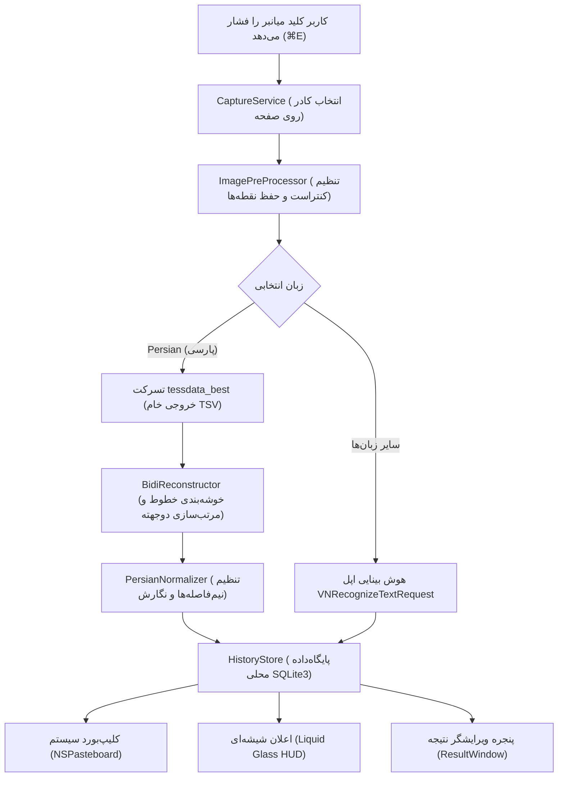

<p align="center">
  
</p>

<h1 align="center">اسنپ‌تکست (SnapText)</h1>

<p align="center">
  <strong>نرم‌افزار بومی، پرسرعت و کاملاً آفلاین منوبار مک‌او‌اس برای استخراج متن (OCR) با موتور پیشرفته بازسازی متون دوجهته پارسی و هوش بینایی اپل (Apple Vision).</strong>
</p>

<p align="center">
  <a href="README.md">English</a> •
  <a href="README.fa.md">پارسی</a>
</p>

<p align="center">
  
  
  
  
  
</p>

---

<div dir="rtl">

## معرفی نرم‌افزار

**اسنپ‌تکست (SnapText)** یک ابزار اختصاصی و سبک برای نوار منوی سیستم‌عامل مک (macOS) است که با هدف رعایت کامل حریم خصوصی و عملکرد کاملاً آفلاین توسعه یافته است. با این برنامه می‌توانید در کسری از ثانیه هر ناحیه‌ای از صفحه نمایش را برش بزنید (Snip)، متن موجود در آن را استخراج نمایید و بلافاصله در کلیپ‌بورد کپی کرده یا در پایگاه‌داده محلی برنامه ذخیره و مدیریت کنید.

بر خلاف اکثر ابزارهای سنتی OCR که متون ترکیبی راست‌به‌چپ و چپ‌به‌راست (فارسی به همراه اصطلاحات انگلیسی، کدها، اعداد و پرانتزها) را به صورت به هم ریخته و معکوس تحویل می‌دهند، SnapText مجهز به یک **موتور هندسی بازسازی متون دوجهته (BiDi Geometric Reconstructor)** و **نرمال‌ساز هوشمند زبان پارسی** است که ترتیب درست کلمات، حفظ نیم‌فاصله‌های اصیل (ZWNJ) و تصحیح جهت پرانتزها و براکت‌ها را تضمین می‌کند.

</div>

---

## تصاویر محیط برنامه

<p align="center">
  
  <br/>
  <em>منوی سریع و تک‌کلیکه در نوار منوی مک با کلیدهای میانبر مستقیم</em>
</p>

<p align="center">
  
  <br/>
  <em>پنجره ویرایشگر متن استخراج‌شده با تراز طبیعی راست‌چین و فونت وزیرمتن</em>
</p>

<p align="center">
  
  <br/>
  <em>پایگاه‌داده دائمی SQLite برای مدیریت، جستجو و حذف تکی و دسته‌جمعی تاریخچه</em>
</p>

<p align="center">
  
  
  <br/>
  
  
  <br/>
  <em>پنجره تنظیمات چندزبانه منطبق بر استانداردهای طراحی اپل</em>
</p>

---

<div dir="rtl">

## امکانات و قابلیت‌های کلیدی

### ۱. کپچر فوری با یک کلیک
- **استخراج متن (`⌘E`):** انتخاب کادر روی صفحه و استخراج بلادرنگ متن به کلیپ‌بورد.
- **عکس‌برداری از صفحه (`⇧⌘E`):** ذخیره مستقیم تصویر کادر در کلیپ‌بورد بدون اتلاف وقت پردازش متن.
- **کپچر از روی فایل (`⌘3`):** انتخاب فایل عکس از مک و استخراج متن آن به صورت آفلاین.

### ۲. موتور تخصصی زبان پارسی و متون دوجهته (BiDi)
- **خوشه‌بندی هندسی خطوط بصری:** حذف شماره‌گذاری‌های ناقص تسرکت و دسته‌بندی سطرها بر اساس هم‌پوشانی عمودی مختصات کلمات.
- **الگوریتم برگردان سطوح L2 (استاندارد یونیکد):** حل دایمی مشکل پرش پرانتزها، عبارات لاتین و اعداد داخل متون فارسی.
- **پیش‌پردازش حفظ نقطه‌ها (Dot-Survival):** بهینه‌سازی کنتراست تصویر برای حفظ قطعی نقطه‌های ریز حروف فارسی در اسکرین‌شات‌ها.
- **مدیریت هوشمند نیم‌فاصله:** حفظ و تصحیح هوشمندانه نیم‌فاصله‌های معتبر پارسی (مانند `می‌خواهم`، `کتاب‌ها`، `زیباترین`) و تبدیل علائم نگارشی انگلیسی به نگارش صحیح فارسی (`،`، `؛`، `؟`).

### ۳. پشتیبانی چندزبانه با موتور عصبی Apple Vision
- پشتیبانی از بیش از ۱۷ زبان زنده دنیا (انگلیسی، فرانسوی، آلمانی، اسپانیایی، ایتالیایی، چینی، ژاپنی، کره‌ای، روسی و...).
- استفاده از بالاترین سطح دقت شناسایی (`Accurate Level`) برای کپی دقیق متون و کدها.

### ۴. پایگاه‌داده قدرتمند محلی SQLite 3
- ذخیره‌سازی داده‌ها در فایل محلی `~/Library/Application Support/SnapText/captured_notes.sqlite`.
- معماری مدرن **WAL (Write-Ahead Logging)** برای مصونیت کامل در برابر کرش و بسته‌شدن ناگهانی برنامه.
- امکان حذف تکی، انتخاب و **حذف دسته‌جمعی (Batch Delete)**، پاکسازی کامل دیتابیس با تأیید امنیتی، و جستجوی لحظه‌ای میان متون.
- کلید اختصاصی افزودن متن کپی‌شده از کلیپ‌بورد به دیتابیس (*Add Clipboard to Notes*).

### ۵. تجربه اصیل و سازگار با سیستم‌عامل مک
- اعلان‌های مدرن **شیشه‌ای شناور (Liquid Glass HUD)** با انیمیشن ورود و خروج نرم.
- تعبیه بسته فونت محبوب **وزیرمتن (Vazirmatn)** در تمامی پنجره‌ها.
- آیکون استاندارد `.icns` مطابق با مشخصات طراحی اپل (macOS HIG) برای دارک مود و لایت مود.
- اسکریپت ساخت پکیج نصبی حرفه‌ای DMG با پوستر پس‌زمینه اختصاصی.

</div>

---

<div dir="rtl">

## معماری پردازش تصویر و متن

</div>



---

<div dir="rtl">

## جدول کلیدهای میانبر

| کلید میانبر | عملکرد | توضیحات |
| :--- | :--- | :--- |
| `⌘E` | **Capture Text** | استخراج متن از محدوده انتخابی و کپی در کلیپ‌بورد |
| `⇧⌘E` | **Capture Image** | عکس‌برداری فوری از محدوده انتخابی بدون پردازش متن |
| `⌘3` | **Capture Text from File** | باز کردن عکس از دیسک برای استخراج متن |
| `⌘H` | **History / Captured Texts** | باز کردن پنجره مدیریت و پاکسازی دیتابیس تاریخچه |
| `⌘,` | **Preferences** | تنظیمات صدا، میانبرها، زبان و رفتار برنامه |
| `⌘Q` | **Quit** | بستن کامل SnapText |

</div>

---

<div dir="rtl">

## نحوه نصب و بیلد پروژه

### نیازمندی‌ها
- مک‌او‌اس ۱۲.۰ (Monterey) یا جدیدتر
- پردازنده‌های اپل سیلیکون (M1/M2/M3/M4) یا اینتل
- نصب موتور Tesseract از طریق Homebrew:
</div>

```bash
brew install tesseract tesseract-lang
```

<div dir="rtl">

### بیلد از سورس‌کد
</div>

```bash
git clone https://github.com/ParsaAzari/SnapText.git
cd SnapText
./build.sh
```
<div dir="rtl">
فایل کامپایل‌شده در مسیر `build/SnapText.app` قرار می‌گیرد.
</div>

<div dir="rtl">

### ساخت فایل نصبی DMG
برای ساخت فایل نصبی با پوستر و نشانگر درگ و دراپ:
</div>

```bash
./create_dmg.sh
```
<div dir="rtl">
خروجی فشرده در مسیر `build/SnapText.dmg` تولید می‌شود.
</div>

---

<div dir="rtl">

## توسعه‌دهنده و ارتباط

**پارسا آذری (Parsa Azari)**
- وب‌سایت: [parsaazari.com](https://parsaazari.com)
- گیت‌هاب: [@ParsaAzari](https://github.com/ParsaAzari)
- ریپازیتوری پروژه: [github.com/ParsaAzari/SnapText](https://github.com/ParsaAzari/SnapText)

---

## حق نشر و قوانین استفاده (License)

تمامی حقوق مادی و معنوی این نرم‌افزار، سورس‌کدها، طراحی‌ها و دارایی‌های بصری آن برای **پارسا آذری** محفوظ است (All Rights Reserved).

هرگونه کپی‌برداری، بازتوزیع، تغییر، فروش یا استفاده تجاری از این پروژه بدون کسب اجازه کتبی صریح از مالک اثر اکیداً ممنوع بوده و پیگرد قانونی دارد. متن کامل قوانین را در فایل [`LICENSE`](LICENSE) مطالعه فرمایید.

</div>
