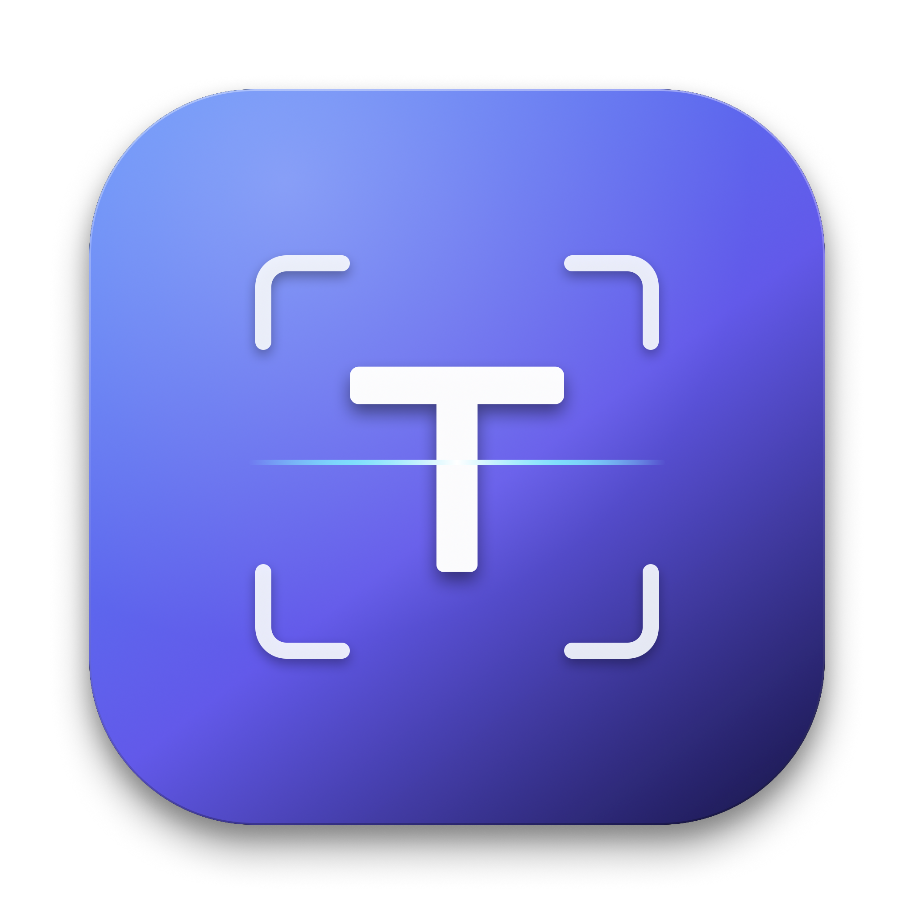
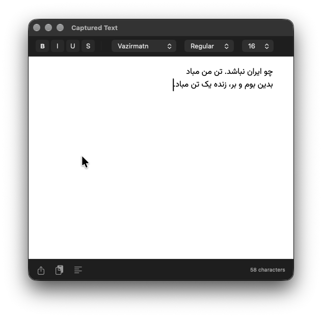
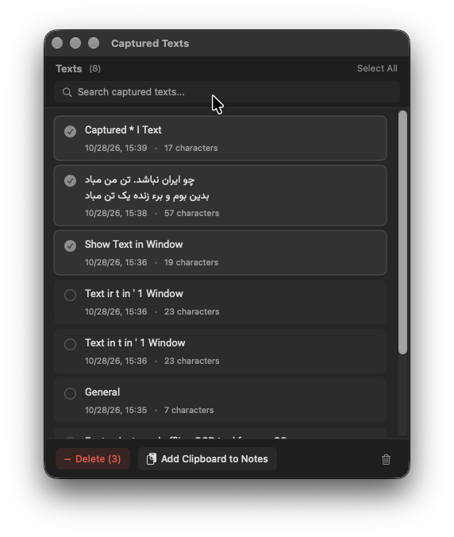
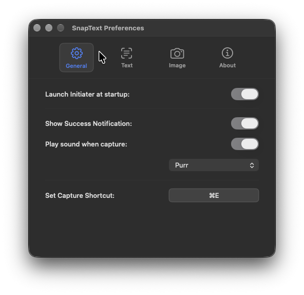
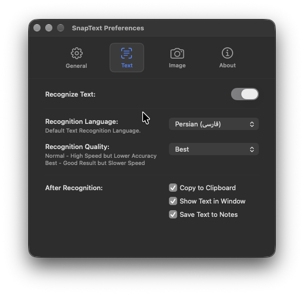
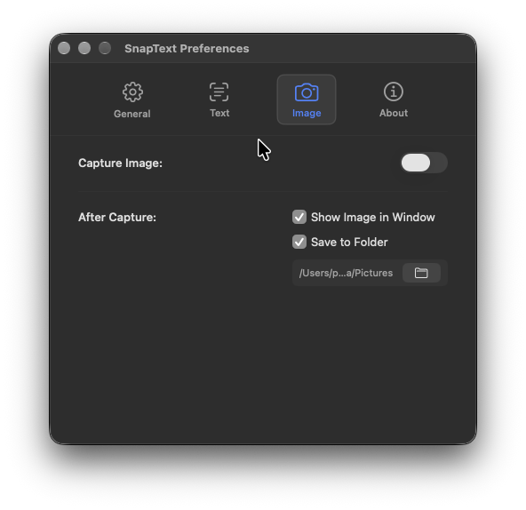
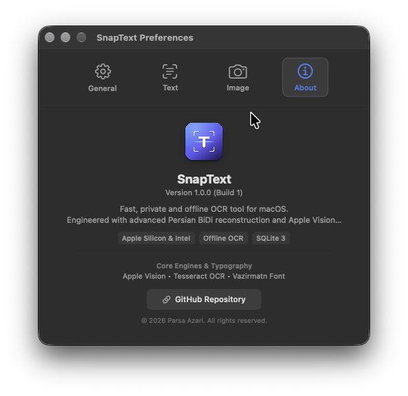
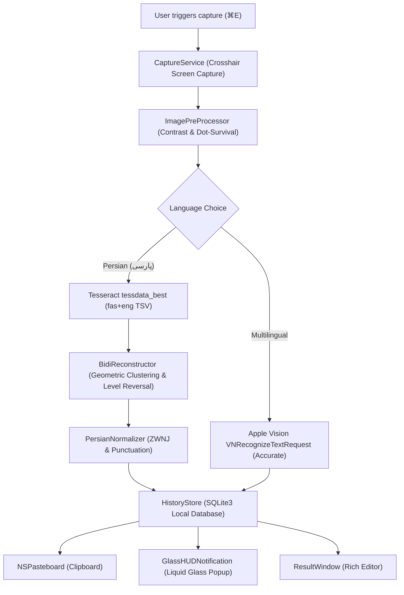

<p align="center">
  
</p>

<h1 align="center">SnapText</h1>

<p align="center">
  <strong>High-performance, native offline OCR menu bar application for macOS with advanced bidirectional Persian (پارسی) reconstruction and Apple Vision intelligence.</strong>
</p>

<p align="center">
  <a href="README.md">English</a> •
  <a href="README.fa.md">پارسی</a>
</p>

<p align="center">
  
  
  
  
  
</p>

---

## Overview

**SnapText** is a lightweight, privacy-focused menu bar utility engineered exclusively for macOS. It allows you to instantly snip any area of your screen, extract text offline with crystal-clear accuracy, and copy it formatted into your clipboard or store it in an indexed local SQLite database.

Unlike standard OCR utilities that scramble mixed bidirectional text (Persian/Arabic mixed with English code, numbers, and parentheses), SnapText features a specialized **BiDi Geometric Reconstructor** and **Persian Normalizer** that guarantees correct reading order, preserved Zero-Width Non-Joiners (ZWNJ / نیم‌فاصله), and mirrored bracket correction.

---

## Screenshots

<p align="center">
  
  <br/>
  <em>Streamlined Menu Bar Actions with Instant Keyboard Shortcuts</em>
</p>

<p align="center">
  
  <br/>
  <em>Rich Result Window with Native BiDi Alignment & Vazirmatn Typography</em>
</p>

<p align="center">
  
  <br/>
  <em>Persistent SQLite Database History with Batch Selection & Cleanup</em>
</p>

<p align="center">
  
  
  <br/>
  
  
  <br/>
  <em>Native macOS Preferences Panel</em>
</p>

---

## Key Features

### 1. Instant Screen Capture & OCR
- **Capture Text (`⌘E`):** Interactive crosshair snipping that immediately extracts text and copies it to your clipboard.
- **Capture Image (`⇧⌘E`):** One-click raw screenshot capture without OCR overhead.
- **Capture from File (`⌘3`):** Import existing image files directly for text extraction.

### 2. Specialized Persian & BiDi Engine
- **Geometric Word Box Reclustering:** Discards flawed Tesseract block segmentations and clusters visual lines by median vertical overlap.
- **Bidirectional L2 Reversal:** Resolves mixed Latin/Persian sentences, parentheticals, URLs, and code snippets in true logical order.
- **Dot-Survival Preprocessing:** Image binarization and contrast adjustments specifically tuned to preserve delicate Persian dots and diacritics.
- **Smart ZWNJ Normalization:** Intelligently preserves and validates legitimate Persian half-spaces (`می‌خواهم`, `کتاب‌ها`, `زیباترین`) while normalizing typographic punctuation (`،`, `؛`, `؟`).

### 3. Multilingual Apple Vision Integration
- Supports 17+ languages using Apple's neural OCR engine (`en-US`, French, German, Italian, Spanish, Portuguese, Chinese, Japanese, Korean, Russian, etc.).
- Runtime language validation with highest accuracy recognition level.

### 4. Robust SQLite 3 Local Database
- Indexed local storage at `~/Library/Application Support/SnapText/captured_notes.sqlite`.
- High-concurrency **Write-Ahead Logging (`WAL`)** mode ensuring zero crash corruption.
- Single-note deletion, multi-selection batch deletion, search filtering, and one-click database cleanup (`Clear All`).
- Direct clipboard insertion via *Add Clipboard to Notes*.

### 5. Native macOS Craftsmanship
- Fluid **Liquid Glass HUD** notification with smooth scale animations.
- Bundled **Vazirmatn** font family for typography.
- Standalone multi-resolution `.icns` app icon adhering to Apple Human Interface Guidelines.
- Automatic installation DMG with customized drag-and-drop installer poster.

---

## How It Works



---

## Keyboard Shortcuts

| Shortcut | Action | Description |
| :--- | :--- | :--- |
| `⌘E` | **Capture Text** | Snip region and copy recognized text to clipboard |
| `⇧⌘E` | **Capture Image** | Snip region and copy raw image directly to clipboard |
| `⌘3` | **Capture from File** | Open image picker to recognize text from disk |
| `⌘H` | **Captured Texts** | Open persistent SQLite history and cleanup window |
| `⌘,` | **Preferences** | Configure audio, hotkeys, languages, and behaviors |
| `⌘Q` | **Quit** | Terminate SnapText |

---

## Installation & Build

### Requirements
- macOS 12.0 (Monterey) or later
- Apple Silicon (M1/M2/M3/M4) or Intel x86_64 Mac
- Tesseract OCR installed via Homebrew:
  ```bash
  brew install tesseract tesseract-lang
  ```

### Build from Source
Clone the repository and run the build script:
```bash
git clone https://github.com/ParsaAzari/SnapText.git
cd SnapText
./build.sh
```
The compiled bundle will be located at `build/SnapText.app`.

### Build Installer DMG
To generate the distribution disk image with custom installer poster:
```bash
./create_dmg.sh
```
Output: `build/SnapText.dmg`.

---

## Author & Contact

**Parsa Azari**
- Website: [parsaazari.com](https://parsaazari.com)
- GitHub: [@ParsaAzari](https://github.com/ParsaAzari)
- Repository: [github.com/ParsaAzari/SnapText](https://github.com/ParsaAzari/SnapText)

---

## License

Copyright © 2026 **Parsa Azari** ([parsaazari.com](https://parsaazari.com)). All Rights Reserved.

This software, its source code, assets, and branding are the proprietary property of Parsa Azari. Unauthorized copying, modification, redistribution, or commercial use without prior written authorization is strictly prohibited. See [`LICENSE`](LICENSE) for full details.
